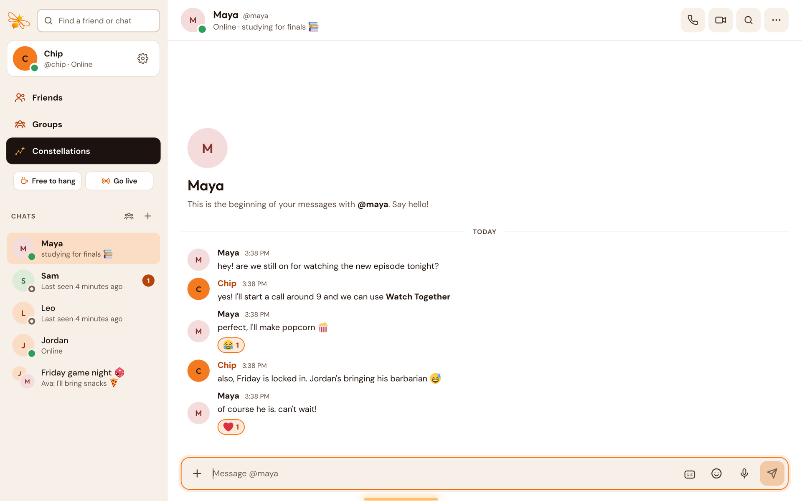
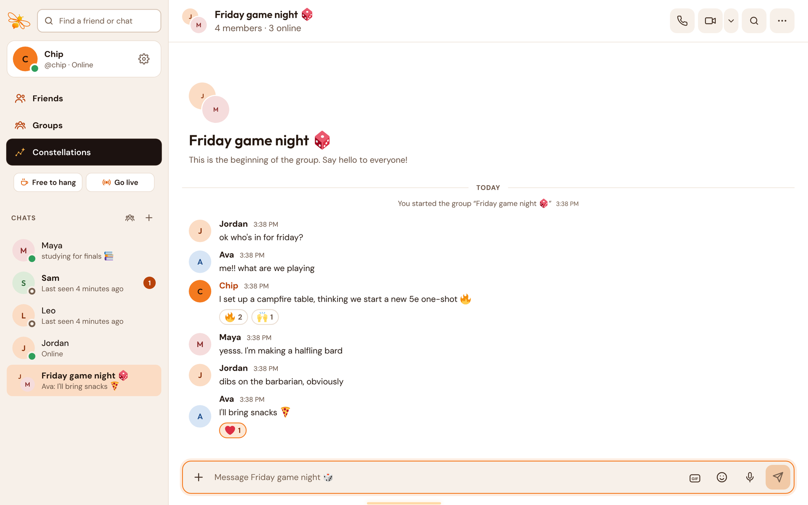
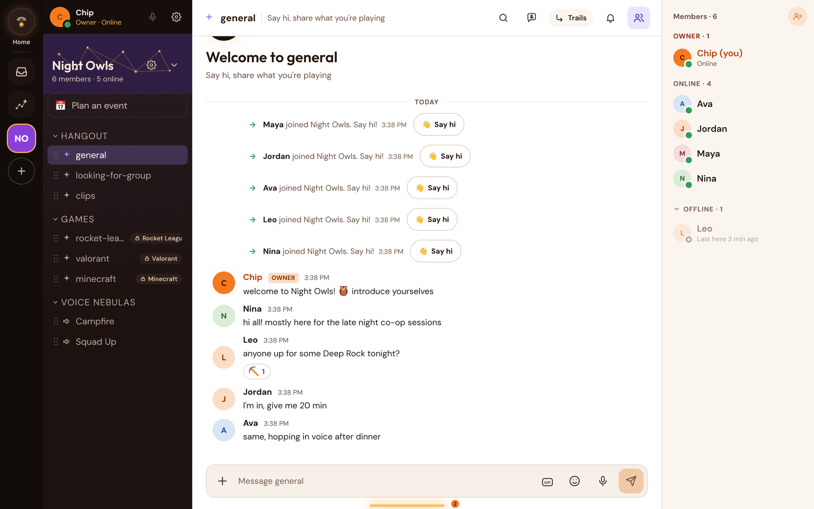
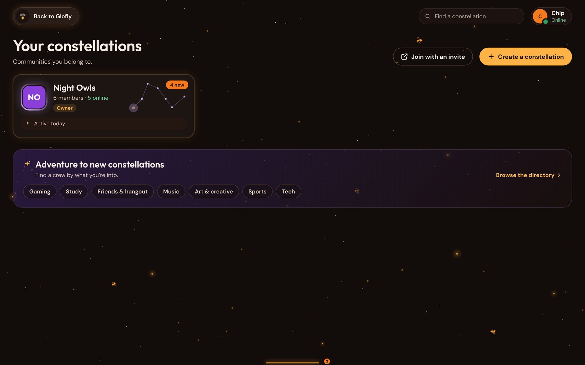
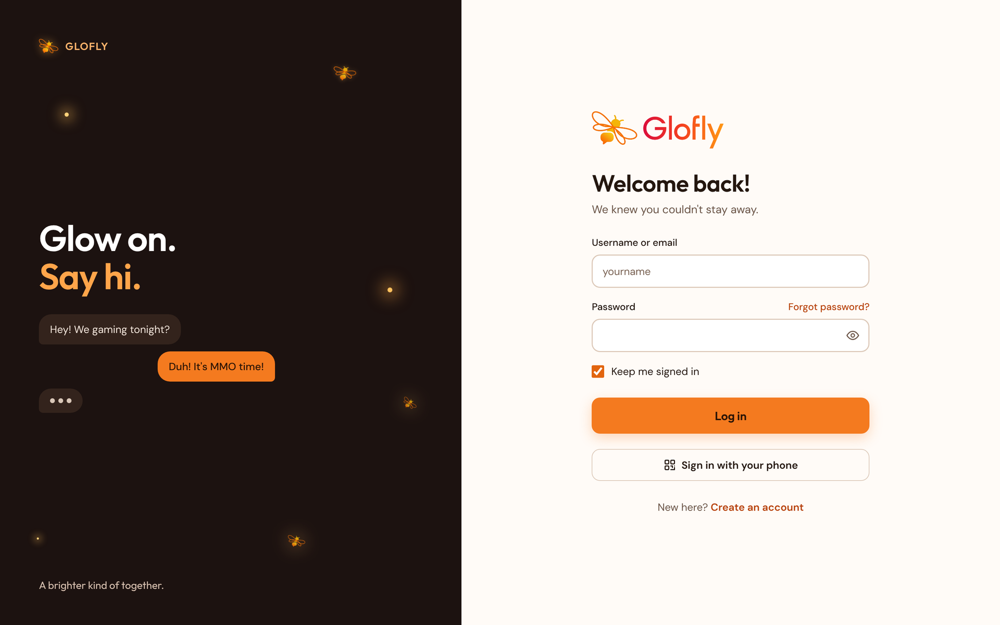

# Glofly ✦

**A messenger for you and your friends, nobody else.** Chat, call, watch videos together, run your own community, and now play 5e tabletop games, all in one app on every platform.

**Live at [glofly.app](https://glofly.app)** · Windows · macOS · iPhone & iPad (App Store) · Android · Web ([chat.glofly.app](https://chat.glofly.app))

---

## About this project

I built Glofly solo, starting in October 2026. I designed and wireframed every screen myself before any code was written, chose the frameworks and the architecture (Electron, Expo, Express, Postgres, LiveKit, AWS), wrote the specs for each feature, tested on real devices, and ran every release. I used **Claude (Anthropic's AI) to help with development**, turning my designs and specs into code that I reviewed, tested and refined.

It isn't a demo. It's a live product with real users, deployed on AWS, updated through versioned releases that keep older app versions working, and supported through my own admin tools.

## Screenshots



| | |
|---|---|
|  |  |
|  |  |

## What it does

- **Messaging.** One-on-one and group chats with replies, reactions, edits, photos, files, voice messages, GIFs, link previews, polls, formatting, pinned messages, search and "send later."
- **Voice & video calls.** One-on-one and group calls up to 25 people, screen sharing with computer sound, adding people mid-call, picture-in-picture, and ringing on the lock screen for phones.
- **Watch Together.** YouTube, Twitch, Vimeo and Kick kept in sync for everyone in a call.
- **Constellations.** Communities of up to 25,000 members with roles and permissions, text, voice, forum, stage and announcement channels, moderation tools, custom emoji, events and onboarding.
- **Campfire.** A 5e virtual tabletop inside calls: maps with fog of war, tokens, a character builder, dice everyone sees, initiative and range-checked attacks. *(In testing.)*
- **Presence & social.** Online, Away, Do not disturb and Invisible; "what I'm playing"; profiles; friend invites; a Windows game overlay.
- **Glofly Control.** A separate admin app for desktop and iPhone (more on it below).
- **Platform.** A bot API, webhooks, "Sign in with Glofly" for my other apps, and a Discord bridge.

## Glofly Control: the admin side

Admin tools aren't hidden pages inside the main app. They're **two separate apps**, Glofly Control for desktop and for iPhone, with their own sign-in and much stricter security than a regular account.

- **What it does.** Account support and data export, moderation and reports, a live dashboard of usage and growth, error reports from every app, cost alerts with a monthly budget, uptime tracking, and push alerts to my phone if the server goes down.
- **Emergency controls.** "Pause Glofly" takes the service offline for maintenance. "Lockdown" stops new friend requests, joins and posts during an attack. "End all calls" does what it says.
- **Two-factor sign-in.** Every admin sign-in needs a password plus a code from an authenticator app.
- **Short sessions.** Desktop admin sessions last 60 minutes and only work from the network they started on. Admin access is also limited to approved IP addresses.
- **Phone pairing.** An iPhone has to be paired once from desktop Control. After that, every request it sends is signed with a key that never leaves the phone. Phone sessions last 30 minutes, with Face ID to sign back in.
- **Audit log.** Every admin action and sign-in is recorded. The database itself refuses to change or delete those records.

## Tech stack

**At a glance:** TypeScript · React · React Native · Expo · Electron · Vite · Node.js · Express · PostgreSQL · Drizzle ORM · Redis · Socket.IO · LiveKit (WebRTC) · Swift · Kotlin · Docker · Caddy · AWS (EC2, RDS, S3) · GitHub Actions

| Part | Built with |
|---|---|
| Server | Node.js, Express 5, TypeScript, PostgreSQL (Drizzle ORM), Redis, Socket.IO |
| Calls | LiveKit (WebRTC) |
| Desktop | Electron, React, Vite (Windows + signed and notarized macOS builds) |
| Web | The desktop app's screens running in the browser, with a service worker and web push |
| Phones | React Native (Expo, expo-router), with native Swift and Kotlin modules for push notifications, call ringing and audio |
| Shared | One `@glofly/shared` package for the API types and rules every app agrees on |
| Hosting | AWS (EC2, RDS, S3), Docker Compose, Caddy (HTTPS) |
| CI | GitHub Actions: Mac builds, Android and iOS build checks |

## How it's organized

```
apps/
  server/          API, real-time events, database, push notifications
  desktop/         Windows + Mac app (Electron)
  web/             The browser version (reuses the desktop screens)
  mobile/          iPhone + Android app (Expo)
  control/         Admin app for desktop
  control-mobile/  Admin app for iPhone
packages/
  shared/          Types, rules and helpers shared by every app
deploy/            Docker, Caddy and server setup
site/              The glofly.app website
```

## How a few key pieces work

**Signing in.** Passwords are hashed with Argon2id, and two-step sign-in by email or text and QR-code sign-in are both available. Each sign-in creates a random session token. The server stores only a SHA-256 hash of it, so a database leak doesn't hand out working sessions. Desktop and phones keep the token in the operating system's secure storage. The browser version uses an httpOnly cookie with CSRF protection.

**Permissions.** The server never trusts the app about who you are or what you can see. Every request is identified from its session, and every read or write checks membership on the server. Asking for a chat you're not in gets "not found," so changing an ID in a request reveals nothing.

**Sending a message.** The app sends an HTTP request. The server checks your session, your membership, the rate limit and the content, then saves the message in a database transaction. It then pushes it over Socket.IO to every member's private room, which reaches all their signed-in devices. Phones that aren't open get a push notification.

**Presence.** Each connected device keeps a key alive in Redis with a heartbeat. Idle devices count as Away. A clean disconnect waits a few seconds before showing "offline," so a Wi-Fi blip doesn't flicker your status. A crashed device is caught when its key expires.

**Shipping safely.** Database migrations only add things, and the server keeps working with the previous app versions, since people update at different times. One command (`npm run release`) versions, tags and builds a release.

**Getting updates to people.** The desktop app checks for an update every time it opens and installs it before the window appears. If it has been open for more than 4 hours, it asks the user to update. The web version always loads the newest release. On phones, most updates arrive over the air in the background, with no App Store or Play Store review. Only changes to native code need a new store build. That was one of the main reasons I chose React Native and Expo: one codebase for iPhone and Android, and fixes that reach everyone the same day.

## Built to grow

Glofly is sized for a small community today, but I made choices so it can grow without a rewrite.

- **Big communities.** Constellations support up to 25,000 members, and I load-tested that. Messages go out to everyone in one pass, member lists load in pages, and per-channel limits stop any one community from slowing the server down.
- **Calls.** Calls run on LiveKit Cloud today, which keeps costs low at this size. LiveKit is open source, so if usage or cost calls for it, it can move onto Glofly's own AWS servers without changing the apps.
- **Text-message codes.** Two-step sign-in by text message is already built on AWS SNS. It's turned off until there's a paid AWS sending number, which is a short setup step, not new code. Email codes work today.
- **Connecting other apps.** Glofly has a bot API, webhooks and a Discord bridge that links a Glofly community with a Discord server in both directions. "Sign in with Glofly" lets my other apps use Glofly accounts. The first is **Gloslate**, an app for roommates that tracks shared expenses and shows who owes whom.

## Running it locally

Requires Node.js 22 and Docker.

```bash
npm install
docker compose up -d                 # PostgreSQL + Redis
cp .env.example .env                 # then fill in your values
npm run db:migrate -w apps/server
npm run dev -w apps/server           # API on http://localhost:4000
npm run dev -w apps/desktop          # desktop app
```

Calls need a LiveKit project (the free LiveKit Cloud plan works). Without one, everything else runs normally.

---

© 2026 Chip Mullins. All rights reserved. This repository is shared for review and isn't licensed for reuse.

Campfire includes material from the System Reference Documents 5.1 and 5.2 by Wizards of the Coast LLC, licensed under [CC BY 4.0](https://creativecommons.org/licenses/by/4.0/).
